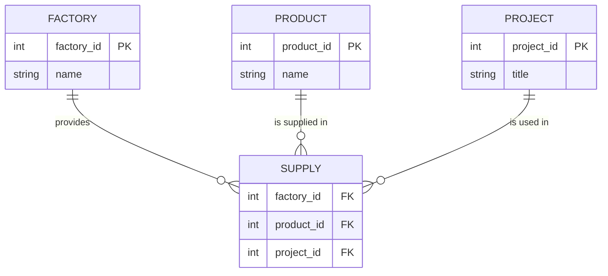

+ **Unary relationship** (recursive) : Table has relationship with itself.
	- Person <=> married
	- Employee <=> Supervise
- **Ternary relationship :** table that has relationship with more then 3 tables.
	- factory --- supply --- product 
				 |
				project 

